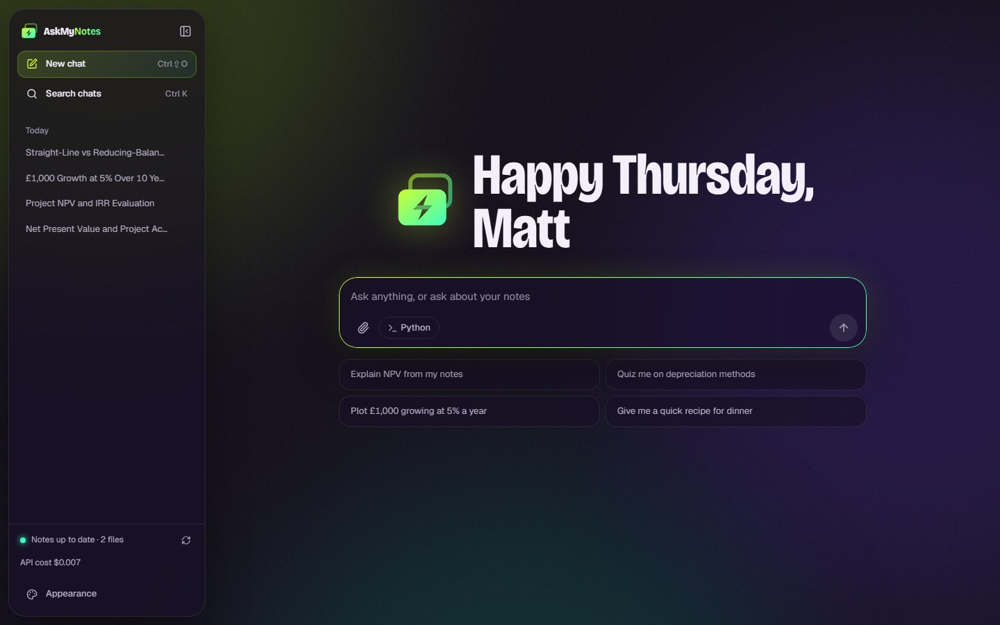
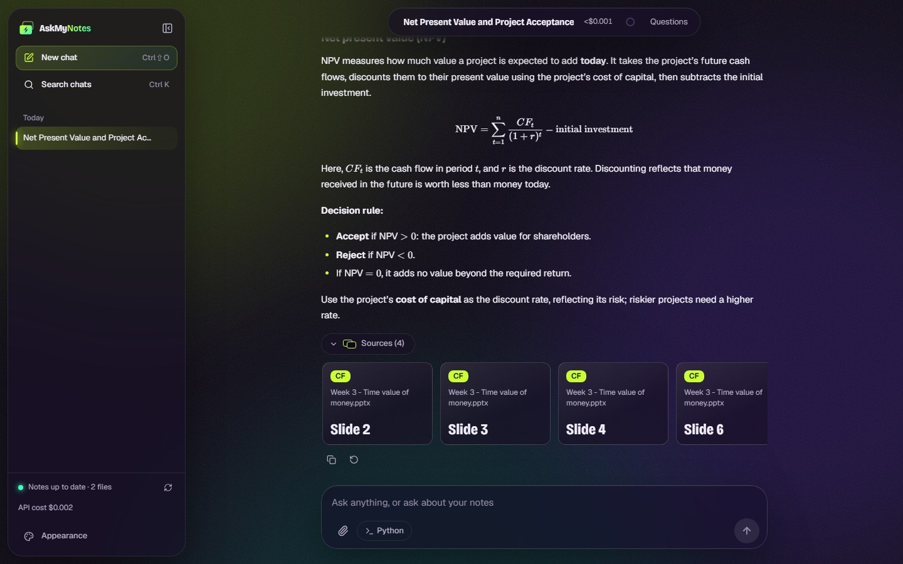
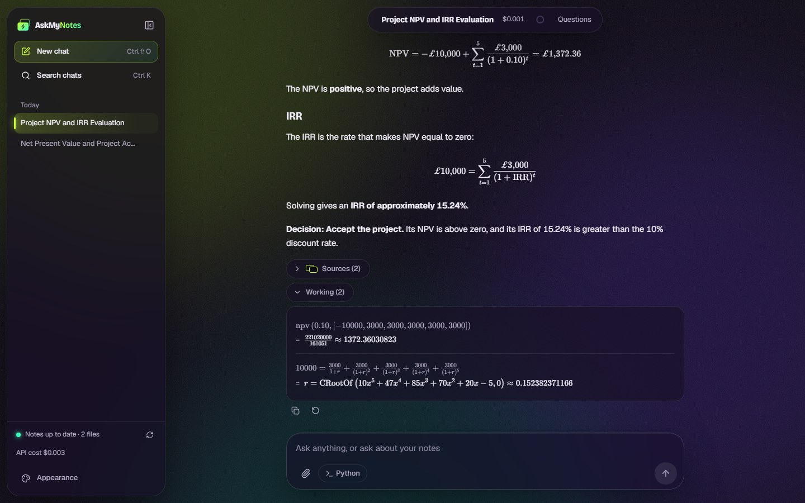
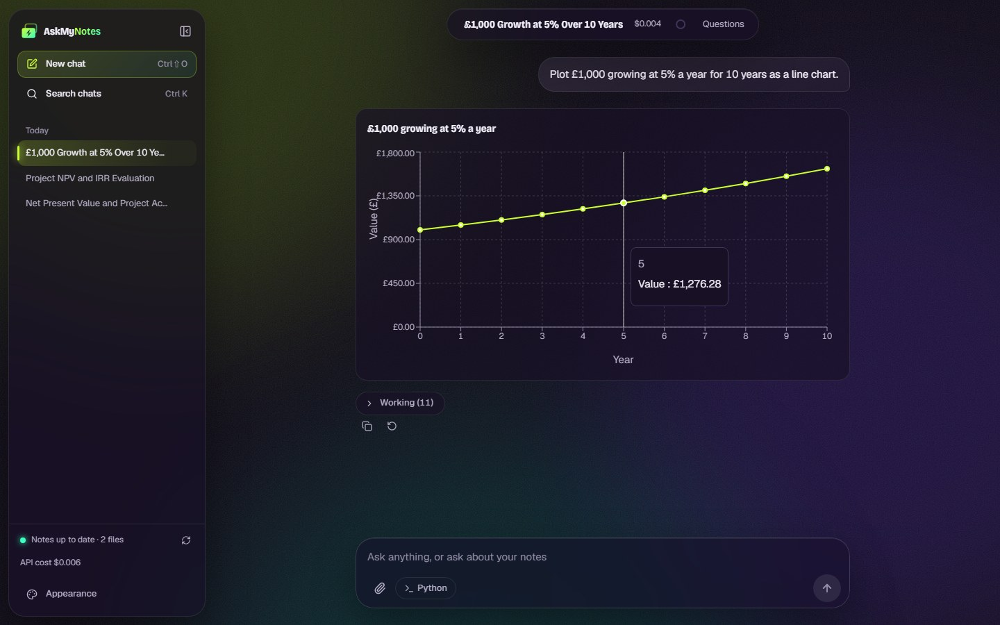
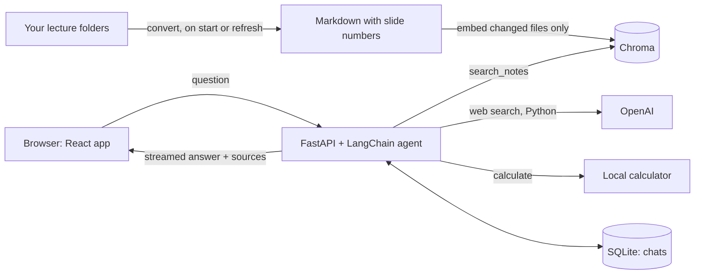

# AskMyNotes

A personal AI study assistant that answers from your own lecture slides and shows the exact slide it used.



## The problem

General AI chatbots give general answers. For a university course, those answers often use
different definitions, methods or formulas from the ones your lecturer taught, and they
don't say where an answer came from. AskMyNotes searches your own lecture slides first,
answers from them, and lists the file and slide number of every source. When it adds
anything from outside your notes, it labels it clearly.

It is also a full general assistant, so one app covers study questions and everyday ones.

This is a full rebuild of my earlier project,
[AskMyNotes-v1](https://github.com/MatthewGilham/AskMyNotes-v1).

## Features

**Answers from your notes**
- Agentic RAG: the AI agent decides when a question needs your notes, writes its own
  search queries, and can search again or limit the search to one or more modules
  ("only from my FR notes").
- Every notes answer lists its sources as slide cards: module, file, slide or page.
- Knowledge from outside your notes is marked **Beyond your notes**. If your notes
  don't cover a topic, it says so.
- Reads PowerPoint (`.pptx`, `.ppt`) and PDF, and keeps slide and page numbers.

**Always up to date**
- Re-indexes automatically on every start, and on "Refresh notes": new, changed and
  deleted files are found by their contents, and only those files are processed.
- A file that is open in another app (such as PowerPoint) is skipped, and the app says so.
- Your notes folders are only ever read, never changed.

**Built-in tools**
- Web search for current information, shown as **From the web** with links.
- A local calculator for maths, statistics and finance (NPV, IRR, PV, FV, PMT), with
  every step shown in a **Working** panel.
- Python (OpenAI Code Interpreter) on request, for data analysis on attached Excel files.
- Charts, Mermaid diagrams, maths rendered as equations, code with syntax highlighting.

**A complete chat app**
- Streaming replies, with Stop, Regenerate, Copy, and editing the latest question.
- Saved chat history with search, pinning, renaming and automatic titles.
- Image and document uploads (Word, Excel, PowerPoint, PDF).
- Long chats are summarised automatically so they keep working.
- Cost and context-window readouts for each chat and for the whole app.
- Ask about a highlighted passage of an answer.
- Three dark themes and a reduced-motion setting.

| Notes answer with sources | Calculation with working | Chart |
|---|---|---|
|  |  |  |

*Screenshots use made-up sample notes, not real course material.*

## Tech stack

| Part | Choice |
|---|---|
| Frontend | React, TypeScript, Vite, CSS Modules, KaTeX, Mermaid, Recharts |
| Backend | Python, FastAPI, Pydantic, uv |
| AI agent | LangChain with the OpenAI Responses API |
| Models | GPT-6 Luna (chat), text-embedding-3-large (embeddings) |
| Notes database | Chroma (vector search) |
| Chat storage | SQLite with full-text search |
| Slide conversion | MarkItDown (PowerPoint), pymupdf4llm (PDF), LibreOffice (old `.ppt`) |
| Tests | pytest (372 tests), Playwright (282 end-to-end tests), Ruff, ESLint |

## How it works



1. **Indexing.** Each slide or PDF page becomes one chunk, tagged with its module, file
   and slide number. A content hash of each file means only changed files are re-embedded.
2. **Answering.** The agent reads the question and the chat so far, and decides which
   tools to call. It searches your notes whenever the question could be in your modules.
3. **Citing.** Each search result has an ID (S1, S2, ...). The agent names the IDs it
   actually used, and the backend turns them into file and slide numbers, so a source
   can never be made up.

## Run it with your own documents

You need [uv](https://docs.astral.sh/uv/), [Node.js](https://nodejs.org/) and an OpenAI
API key. [LibreOffice](https://www.libreoffice.org/) is only needed for old `.ppt` files.

```bash
git clone https://github.com/MatthewGilham/AskMyNotes.git
cd AskMyNotes
uv sync
cd frontend && npm install && cd ..
cp .env.example .env                    # Windows: Copy-Item .env.example .env
cp settings.example.toml settings.toml  # Windows: Copy-Item settings.example.toml settings.toml
```

1. Put your OpenAI key in `.env`.
2. In `settings.toml`, add one `[[modules]]` block for each folder of slides or PDFs:

   ```toml
   [[modules]]
   name = "Corporate Finance"
   short_name = "CF"
   folder = 'C:\Path\To\Corporate Finance\Lecture Slides'
   ```

3. Start the app. It builds the frontend, indexes your notes and opens your browser:

   ```bash
   uv run askmynotes
   ```

The app runs only on your computer, at `http://127.0.0.1:8000`. When an answer needs your
notes, the relevant extracts are sent to OpenAI.

Run the tests (they use a fake model, so they cost nothing):

```bash
uv run pytest
cd frontend
export PLAYWRIGHT_BROWSERS_PATH=0   # keeps the test browser inside the project
npx playwright install chromium
npx playwright test
```

## Evaluation

I tested the app on 50 questions written from my own lecture slides, 10 for each of five
modules. The questions cover facts, definitions, calculations, questions that span several
slides, paraphrased questions, and topics the notes don't cover. A separate set of 10
checks behaviour: everyday questions must not search the notes, and module filters must
be followed. A GPT-6 Luna judge compared each answer with a reference answer.

| Measure | Result |
|---|---|
| Retrieval: mean reciprocal rank (MRR) | 0.91 |
| Retrieval: nDCG | 0.87 |
| Keyword coverage | 93% |
| Answer accuracy (judge, out of 5) | 4.98 |
| Answer completeness (judge, out of 5) | 4.10 |
| Answer relevance (judge, out of 5) | 4.92 |
| Behaviour checks passed | 10 / 10 |

The question set is not published, because it is based on university course material.
The score history is in [`evaluation/results/history.csv`](evaluation/results/history.csv).
To evaluate on your own notes, write `evaluation/tests_small.jsonl` with one question per line:

```json
{"question": "What is NPV?", "keywords": ["net present value"], "reference_answer": "...", "category": "definition", "module": "Corporate Finance"}
```

Then run `uv run askmynotes-eval` (this calls the real models and costs money).

## How it was built

I directed and reviewed the work; AI coding agents planned, built and tested it in 37
small phases, each checked with automated tests, screenshots and a browser walkthrough. The specification, plan and process documents are in
[`docs/`](docs/), and the agent's instructions are in [`AGENTS.md`](AGENTS.md).
